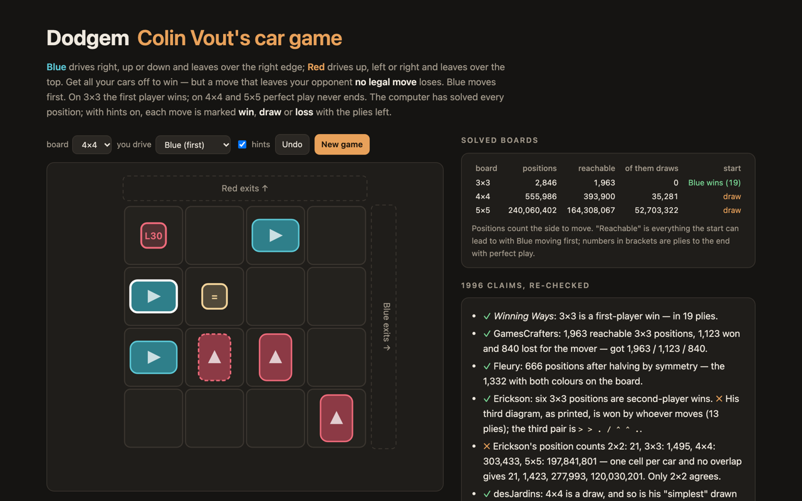

# Dodgem — Colin Vout's car game against a perfect player, and the 1996 claims rechecked



**Dodgem** in the browser, against a perfect player. On an *n*×*n* board each side has *n*−1 cars. Blue starts on
the left edge and drives right, up or down; Red starts on the bottom edge and drives up, left or right. Cars leave
the board only over the far edge (right for Blue, top for Red). You win by getting all your cars off — but a move
that leaves your opponent without a legal move loses, so a player who is boxed in has won. Blue moves first.

The game was invented by Colin Vout in 1972 and appears in *Winning Ways*. The 3×3 board is a first-player win.
In 1996 David desJardins reported on rec.games.abstract that 4×4 and 5×5 are draws: with perfect play the cars
shuffle sideways forever. The computer here has solved every position of the 3×3 and 4×4 boards (in the page) and
of the 5×5 board (offline, 240 million positions). With hints on, every move is marked win, draw or loss with the
number of plies left.

TypeScript, no runtime dependencies.

## The solver

[`src/dodgem.ts`](src/dodgem.ts). A position is Blue's cars and Red's cars as two bitmasks plus the side to move.
Cars never come back once they have left, so positions fall into layers by (Blue cars on the board, Red cars on the
board), and every move stays in its layer or drops into a layer with one car fewer. The layers are solved from the
emptiest up:

1. **Indexing.** Inside layer (*a*, *b*), Blue's cars are an *a*-subset of the *n*² cells and Red's a *b*-subset of
   the remaining cells; both are ranked with the combinatorial number system (colex), so the layer is a dense array
   of 2·C(*n*², *a*)·C(*n*²−*a*, *b*) bytes with no hashing.
2. **Seeding.** For every position, moves that drive a car off look up the already-solved layer below. A position
   with no legal move is a win for the side to move (the opponent broke the rule). A position whose every move is a
   known win for the opponent is a loss.
3. **Retrograde sweep.** Positions are processed in increasing depth. A lost position makes every predecessor a win
   one ply longer; a won one decrements its predecessors' counters, and a predecessor whose counter reaches zero is a
   loss as long as its longest move. Predecessors are generated by *un-moving* a car (left, down or up for Blue; down,
   left or right for Red), which never leaves the layer.
4. Whatever is never labelled is a **draw**.

Depths are exact plies to the end with perfect play (fastest win, slowest loss), which is what the computer uses to
choose its moves; in a drawn position it picks a drawing move at random.

The tests check the solver against an independent one — plain value iteration over a `Map` of every position, no
layers, no ranking, no un-moves — on all 2,846 positions of 3×3 and all 555,986 of 4×4, value **and** depth.

## What came out

`npm run stats` solves 3×3, 4×4 and 5×5 into `runs/stats-<n>.json`; `npm run literature` replays the claims from the
thread and writes [`src/results.json`](src/results.json). Node 26 on a 12-core Mac mini; 5×5 takes 323 s to solve
(the largest layer, 4 cars against 4, has 151,420,500 positions and takes 204 s) and 629 s with the statistics, at a
peak of 928 MB.

| board | positions (with side to move) | reachable from the start | draws among those | start | longest forced win |
|---|---:|---:|---:|---|---:|
| 3×3 | 2,846 | 1,963 | 0 | first player wins in 19 plies | 21 |
| 4×4 | 555,986 | 393,900 | 35,281 | draw | 42 |
| 5×5 | 240,060,402 | 164,308,067 | 52,703,322 | draw | 81 |

| claim | source | result |
|---|---|---|
| 3×3 is a first-player win | *Winning Ways* | yes; the only winning first move is the car farthest from the corner |
| 1,963 reachable 3×3 positions, 1,123 won and 840 lost for the mover, no draws | GamesCrafters (via Wikipedia) | identical |
| 666 legal 3×3 positions after dividing by two for symmetry | Marc Fleury, 4 Mar 1996 | identical: the 1,332 positions with both colours on the board |
| three 3×3 positions (six with reflections) are second-player wins | Jeff Erickson, 4 Mar 1996 | six, yes — but his third diagram is not one of them (below) |
| 21 / 1,495 / 303,433 / 197,841,801 legal positions on 2×2 … 5×5 | Jeff Erickson, 11 Mar 1996 | **only 2×2 agrees**: placing *n*−1 cars a side on distinct cells gives 21 / 1,423 / 277,993 / 120,030,201 |
| the 4×4 start, and his "simplest" drawn position, are draws | David desJardins, 18–19 Mar 1996 | yes |
| 1. b1-a1 loses on 4×4 but draws on 5×5 | desJardins, 20 Mar 1996 | yes (on 4×4 in 38 plies) |
| the 5×5 start is a draw | desJardins, 20 Mar 1996 | yes |
| "about 40% of 5×5 positions are draws" | desJardins, 20 Mar 1996 | 35.7% of the positions with both colours on the board; 32.1% of the reachable ones |
| a drawing line from the 4×4 start, "!" = the only drawing move | desJardins, 19 Mar 1996 | every "!" checks out — but O's first reply loses (below) |

**Erickson's third diagram.** He printed the three second-player wins as

```
. > >     > . .     > > .
. . ^     ^ . .     . . ^
. . .     . . .     . . ^
```

The first two are second-player wins. The third, as printed, is won by whoever moves, in 13 plies. The real third
pair is `> > . / ^ ^ . / . . .` and its reflection `. . . / . > ^ / . > ^`. The printed diagram takes its Blue cars
from the former and its Red cars from the latter.

**desJardins' line.** After 1. d1-d2 (his notation: X moves up from the bottom and moves first, O moves right), O has
four moves. a2-b2 and a3-b3 draw; a2-a1 loses in 32 plies; the a4-b4 he played loses in 38 — X's 2. c1-c2 wins.
X's 2. d2-d3 gives the draw back, and from there on every position of the line is a draw and each of his three "!"
moves is indeed the only drawing move. One move is not legal as written: 12. d3-off, with no car on d3; the diagram he
prints after it fits c4-off.

**Erickson's counts.** His numbers are larger than the number of ways to place the cars on distinct cells at all
(Σ C(*n*², *a*)·C(*n*²−*a*, *b*) over 0 ≤ *a*, *b* ≤ *n*−1), so they count something else, and the post does not
say what. It is not the side to move either: that doubles the count to 2,846 / 555,986 / 240,060,402.

## Run it

```sh
npm install
npm run dev        # the game
npm test           # 16 tests, about 45 s (the 4×4 cross-check dominates)
npm run stats      # solve 3×3, 4×4, 5×5 (5×5: ~10 minutes, ~1 GB)
npm run literature # rebuild src/results.json from runs/
```

## Sources

- [“Dodgem” . . . any info?](https://www.ics.uci.edu/~eppstein/cgt/dodgem.html) — the 1996 rec.games.abstract thread,
  archived by David Eppstein (Erickson, Fleury, desJardins, Hoey).
- E. R. Berlekamp, J. H. Conway, R. K. Guy, *Winning Ways for your Mathematical Plays*.
- [Dodgem](https://en.wikipedia.org/wiki/Dodgem) on Wikipedia, for the rules and the GamesCrafters figures.

## License

MIT. See [LICENSE](LICENSE).

<!-- sen-publish:links -->
## Links

- 🌐 Demo: https://sen.ltd/portfolio/dodgem/
- 📝 記事: https://qiita.com/sen-ltd/items/36cfd0b15eca2b0bb2d2
<!-- /sen-publish:links -->
